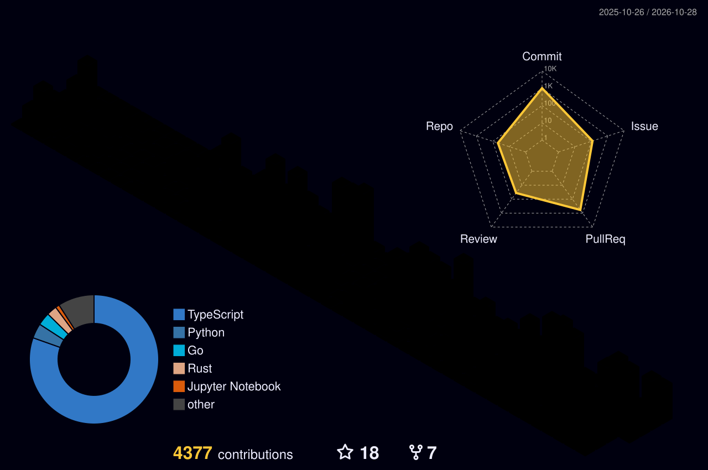

# Francisco Perez

**I build AI systems that actually ship** — multi-agent apps, RAG pipelines, and automations that end up used by real teams.

Software / AI Engineer in Tucumán, Argentina · final-year Information Systems Engineering @ UTN-FRT. I turn messy real-world problems into working software, usually with an LLM in the loop.

🏆 **NASA Space Apps 2024 — National Winner** ([ExoGames](https://github.com/FranprzDev/NASASpaceApp-Marshall-Arg)) · national competitor 2025 ([BeeAgro](https://github.com/FranprzDev/BeeAgro-Spanish))

---

## What I'm doing now

- **Software / AI Engineer @ RepuestoShop** (Dec 2025 – present) — multi-agent systems + custom RAG with LangChain/LangGraph, internal tools on Meta APIs, and scraping pipelines for data grounding.
- **Full-Stack Developer (volunteer) @ Fundación Líderes de Ansenuza** (Apr 2025 – present) — leading the foundation's digital transformation: web platform and internal management tools.
- **Studying and going deeper into AI** — agents, RAG and LLM engineering, alongside my final year of Information Systems Engineering at UTN-FRT.

## Selected work

**[Proofy](https://github.com/FranprzDev/Proofy)** — *Superteam Argentina hackathon (Colosseum), Oct 2026.* An AI agent turns a contract's scope into verifiable milestones, and a Solana escrow program (Anchor) releases SOL per milestone based on CI/CD evidence. Devnet prototype. [Live app](https://proofyai.vercel.app) · [Colosseum page](https://colosseum.com/arena/projects/proofy-1)

**[Scope-to-Profit](https://github.com/FranprzDev/ScopeProfit)** — *scope copilot for freelancers and agencies, 2026.* An AI agent turns a client's scattered ideas (text and images) into a formal scope document: requirements with quotes, blocking questions, risks, in/out of scope and an hour-range estimate. Client chat in Next.js, the professional manages projects from a Telegram bot, and a backend agent keeps a versioned brief in PostgreSQL and exports PDF/DOCX. [Live app](https://scope-profit-web.vercel.app)

**Tax-deadline platform for La Vista Casal** — *freelance, Nov 2025 – Aug 2026.* Co-built an accounting firm's tax due-date calendar with approval flows, change history, and Google Calendar/Gmail integration. Running in production, delivered with a technical report, executive summary, and user guide.

**[n8n-nodes-timed-buffer](https://github.com/FranprzDev/n8n-nodes-timed-buffer)** — a published community n8n node: a Redis-backed, time-windowed message buffer. Built because n8n had no clean way to batch bursts of events.

**[Scrapping-Repuestos-UY-API](https://github.com/FranprzDev/Scrapping-Repuestos-UY-API)** — NestJS API that turns messy spare-parts catalogs into clean data: HTTP + JSON-LD first, Playwright fallback, quality gate.

**[apuntes-cli](https://github.com/FranprzDev/apuntes-cli)** — CLI that turns raw class material into compact FAQs and final-exam notes, per subject.

*Also around:* [gpozos-game](https://github.com/FranprzDev/gpozos-game) (water-network investments vs a Linear Programming optimum).

## Background

- **Instructor, Process Automation with n8n — Tucumán Judiciary** (Sep – Oct 2025) — designed and taught a 20h course for court staff (own materials, live builds, APIs/webhooks, RAG + human-in-the-loop) and presented the automation strategy to leadership.
- **Product Engineer @ RollingCode Studio** (Oct 2024 – Dec 2025) — frontend and backend features for client web projects in Scrum teams with Git Flow and code review; automated internal tasks with n8n.
- **Teaching Assistant, Web & Backend @ RollingCode School** (Nov 2023 – Aug 2024)

## Hackathons

- **Superteam Argentina / Colosseum 2026** — [Proofy](https://github.com/FranprzDev/Proofy) (submitted)
- **NASA Space Apps 2024** — National Winner ([ExoGames](https://github.com/FranprzDev/NASASpaceApp-Marshall-Arg)) · **2025** — national competitor ([BeeAgro](https://github.com/FranprzDev/BeeAgro-Spanish))
- **Vortex Software n8n Hackathon 2025** — on-site, Tucumán

## Stack

TypeScript · JavaScript · Python · SQL · Next.js · React · Tailwind · NestJS · Node · Express · Postgres · Supabase · Redis · MongoDB · Docker · AWS · Vercel · Netlify · Linux

`LangChain · LangGraph · n8n · RAG · agent harness · tool calling · OpenAI · Anthropic · Gemini · Playwright · Solana · Anchor`

## Stats

    

## Connect

